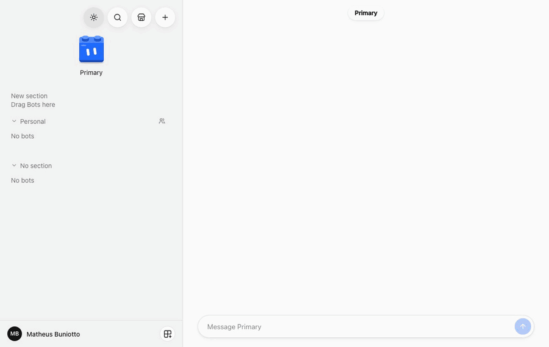

# BricksBot

**Grok-shaped multi-bot chat for Databricks workspaces** — Spaces, a bot roster, durable chat, lakehouse tools, approvals, and routines. Install as a Databricks App from this repo (DAB + source). Not a Marketplace-only container; not a Rakazo fork.

| | |
| --- | --- |
| **Is** | Workspace-installable AppKit app; OpenAI-compatible or Serving LLMs; SQL / UC catalog / Volume read / web fetch; Primary → teammate handoff; Ask-first approvals; scheduled routines via Job → webhook; optional sandbox exec |
| **Is not** | Desktop/browser “computer” UI; always-on Genie; PartnerOps listing required |

System architecture: [docs/architecture.md](docs/architecture.md). Documentation index: [docs/README.md](docs/README.md). Product locks: [docs/project-context.md](docs/project-context.md). Community release map: [docs/oss-community-release.md](docs/oss-community-release.md). What’s next: [docs/roadmap-next.md](docs/roadmap-next.md).

<p align="center">
  
</p>

## Highlights for Databricks Teams

- **Runs inside Databricks**: Deployed via Databricks Asset Bundles (DAB) directly into your workspace as an AppKit application. No external proxy; durable state lives in your PostgreSQL Lakebase.
- **Multi-Agent Roster & Handoff**: Front-desk Primary bot routes tasks to specialized teammates (e.g., SQL Analyst, Experimentation Engine, Routine Runner) with bidirectional transcript links.
- **Strict 3-Way Human Approvals**: `[Always allow (A)]` `[Approve Once (B)]` `[Deny (C)]`. Mutating SQL, volume writes, and sandbox operations require explicit operator consent.
- **Native Lakehouse Tools**: Serverless SQL queries with strict row/byte caps, Unity Catalog schema exploration, and namespaced Volume I/O with Lakebase storage quotas.
- **Zero-Egress Serving Option**: Connect to external OpenAI-compatible models (OpenRouter) or keep everything inside your VPC with Databricks Model Serving (DBRX, Llama 3 70B).
- **Scheduled Lakeflow Routines**: Automated recurring agent prompts triggered via Databricks Jobs and authenticated webhooks.

### Example Walkthrough: Multi-Agent Lakehouse Analysis

1. **User asks**: *"Analyze our top 5 enterprise accounts by churn probability and graph revenue at risk."*
2. **Primary evaluates & delegates**: Primary plans the approach and executes `handoff_to_bot("SQL Analyst", ...)`. A clean handoff badge appears in both bot chats.
3. **Preflight human approval**: The SQL Analyst evaluates the generated SQL query against Serverless SQL warehouse boundaries and pauses the turn with a 3-way approval card.
4. **One-click signoff**: The operator reviews the SQL statement and approves (`Once` or shortcut `B`). The query executes in 28ms with Unity Catalog governance and row limits.
5. **Chart auto-pinning**: An interactive Vega-Lite chart pins directly to the transcript showing MRR exposure per account.
6. **Automated routine**: The analyst schedules a weekly Lakeflow Job webhook routine to track future churn alerts automatically.

## Prerequisites

- Node.js 22+ and npm
- [Databricks CLI](https://docs.databricks.com/aws/en/dev-tools/cli/install) ≥ 1.0.0 and a profile in `~/.databrickscfg`

```bash
databricks -v
databricks current-user me -p <profile>
```

## Smoke path (local)

Cold clone, no Databricks required:

```bash
npm ci
npm test
npm run build
npm run dev          # http://localhost:8000 — stub LLM + in-memory store
```

Copy `.env.example` → `.env` only if you need overrides. Without an LLM key the stub client answers; without Lakebase env the server uses memory. Enough to click the roster and chat UI.

## Install on a workspace

You need: **App** + **Lakebase** (durable chat) + **secret for an LLM** (or Serving). A SQL warehouse is optional but required for interactive `sql_query` / `lakehouse_catalog`.

### 1. Workspace variables

Committed `databricks.yml` has no personal hosts or Lakebase paths. Copy the example and fill **your** values:

```bash
cp dev.local.yml.example dev.local.yml
# edit lakebase_branch, lakebase_database, sql_warehouse_id
```

`dev.local.yml` is gitignored and already picked up via `include: '*.local.yml'`. Alternatively pass `--var` / `BUNDLE_VAR_*` at deploy time.

### 2. Lakebase (BYO)

Create or reuse a Lakebase Autoscaling project/branch (workspace project limits apply). Details: [`resources/lakebase.postgres.yml.stub`](resources/lakebase.postgres.yml.stub).

```bash
databricks postgres list-projects -p <profile>
# create-project / list-branches / list-databases as needed
```

Set in `dev.local.yml`:

- `lakebase_branch`: `projects/<project>/branches/<branch>`
- `lakebase_database`: `…/databases/databricks-postgres` (typical id)

Schema `bricksbot` is owned by the App service principal after the first successful App deploy.

### 3. Secrets and egress

Default LLM secret scope/key: **`bricksbot` / `openrouter-api-key`**.

```bash
databricks secrets create-scope bricksbot -p <profile>   # if missing
databricks secrets put-secret bricksbot openrouter-api-key --string-value 'YOUR_KEY' -p <profile>
# optional web_fetch hosts (comma-separated); tool stays off if unset
databricks secrets put-secret bricksbot web-fetch-allowlist --string-value 'docs.databricks.com' -p <profile>
```

| Need | Notes |
| --- | --- |
| LLM egress | OpenRouter (`openrouter.ai`) or your compatible base URL; or bind Serving (see `app.yaml` comments) |
| SQL tools | Warehouse `CAN_USE` for the App SP; user needs UC grants (OBO via `sql:restricted-query`) |
| `volume_read` | User needs Volume read; App declares `files.files` |
| `volume_write` | Set `BRICKSBOT_VOLUME_ROOT` to a `/Volumes/...` path. The signed-in user needs write on that volume. Each user gets `users/{user}/bots/{bot}/`. Default caps are 8 MiB per write and 256 MiB per user. Routine runs cannot call `volume_write`. |
| Sandbox | `SANDBOX_BACKEND=databricks` in `app.yaml` (falls back to `python_exec` if Sandboxes preview is off). Set `off` to disable. |

Serving instead of OpenRouter: bind a `serving-endpoint` resource and set `LLM_PROVIDER=databricks` (comments in `app.yaml`).

### 4. Deploy

```bash
databricks bundle validate -p <profile>
databricks bundle deploy -p <profile>
databricks bundle run app -p <profile>
# or: databricks apps deploy -p <profile>
```

```bash
databricks apps get bricksbot -p <profile>
databricks apps logs bricksbot -p <profile>
```

Open the App URL → chat with **Primary**. First-run wizard appears when the provider is still stub (missing secret). With a warehouse bound, try a simple SQL question after approving `sql_query`.

## What shipped

- Spaces, bot roster, presence (`online` / `thinking` / `working` / `waiting` / `blocked`), transcript, composer, 3-way approvals
- Durable chat on Lakebase (memory fallback locally); compaction; `requestId` idempotency
- Tools: `sql_query`, `lakehouse_catalog`, `volume_read`, `volume_write` (when `BRICKSBOT_VOLUME_ROOT` is set), `web_fetch`, `handoff_to_bot`, `create_bot`, pins / charts, meta skills & memory
- Routines (cron metadata + webhook + Test) and example Lakeflow Job → webhook ([`resources/jobs/routine-webhook.job.yml`](resources/jobs/routine-webhook.job.yml))
- Optional Phase 5 sandbox exec behind `SANDBOX_BACKEND`

Approvals: **All the time** / **Once** / **Not approve** (shortcuts `A`/`B`/`C`). Meta tools and `list_routines` auto-run; sandbox and several pin/routine tools stay Ask-first.

### Scheduled routines (Job → webhook)

After deploy, create a routine in Bot details, store the one-time webhook secret, set `routine_webhook_*` vars (see Job file + `dev.local.yml.example`), redeploy, enable the routine, and Run now on Job `bricksbot_routine_webhook`. Full checklist lives under the Job resource comments and [docs/specs/2026-10-30-lakeflow-routine-job.md](docs/specs/2026-10-30-lakeflow-routine-job.md).

## Develop

```bash
npm ci
npm run dev
npm test
npm run typecheck && npm run lint
```

Layout: `client/` UI, `server/` API + agent loop, `shared/` types. Conventions: [AGENTS.md](AGENTS.md), [CONTRIBUTING.md](CONTRIBUTING.md).

## Out of scope (for now)

No Vector Search yet (Ask-first `volume_write` with user/bot namespaces is supported). No Genie by default (opt-in later — [docs/databricks-platform-integration-plan.md](docs/databricks-platform-integration-plan.md)). No PartnerOps Apps listing required for this OSS path. Desktop “computer” UI stays deferred; sandbox exec is the Phase 5 path.

## License

Apache-2.0 — see [LICENSE](LICENSE).
