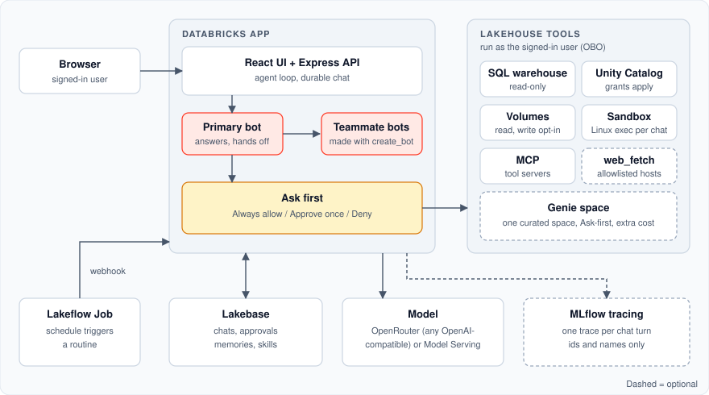

# BricksBot

A multi-bot chat assistant that runs inside your Databricks workspace as a Databricks App. Bots query your lakehouse as the signed-in user, ask before they act, and keep their chats, memories and approvals in your own Lakebase.

[](https://github.com/matheusbuniotto/bricksbot/actions/workflows/ci.yml)
[](LICENSE)

<p align="center">
  
</p>

## What it does

- **Bots in Spaces.** A Primary bot answers first and hands work to teammate bots (`handoff_to_bot`). Spaces let you share bots with viewers, members and admins.
- **Lakehouse tools.** `sql_query` (read-only), `lakehouse_catalog` and `volume_read` run On-Behalf-Of the signed-in user, so Unity Catalog grants, row filters and masks apply. `volume_write` and `web_fetch` are opt-in.
- **Approvals.** Data tools stop for **Always allow / Approve once / Deny** before they run. Decisions are recorded in Lakebase.
- **Durable state.** Chats, memories, skills and approvals live in Lakebase (schema `bricksbot`). Long chats are compacted for the model; the transcript is never deleted.
- **Routines.** A Lakeflow Job can send a prompt to a bot on a schedule.
- **Sandbox.** Optional Linux exec per chat, with artifacts saved to a Unity Catalog Volume.
- **Models.** Any OpenAI-compatible API (OpenRouter by default) or a Databricks Model Serving endpoint.

Not included: a desktop or browser-control UI, and always-on Genie (Genie is opt-in because it costs more).

## How it fits together

<p align="center">
  
</p>

Details: [docs/architecture.md](docs/architecture.md).

## Try it locally

No Databricks account needed. Without credentials it uses an in-memory store and a stub model.

```bash
git clone https://github.com/matheusbuniotto/bricksbot.git
cd bricksbot
npm ci
npm run dev
```

Open http://localhost:8000. To use a real model or Lakebase locally, copy `.env.example` to `.env` and fill it in.

## Deploy to a workspace

You need the Databricks CLI, a Lakebase project, an LLM API key (or a Serving endpoint) and, for SQL tools, a SQL warehouse.

### Quick setup

```bash
npm ci
npm run bootstrap -- -p <profile>
```

This picks (or creates) a Lakebase project and a SQL warehouse, stores your OpenRouter key in secret scope `bricksbot`, writes `dev.local.yml` and validates the bundle. Then [deploy](#deploy).

### Manual setup

1. Copy `dev.local.yml.example` to `dev.local.yml` (gitignored) and set `lakebase_branch`, `lakebase_database` and `sql_warehouse_id`. List Lakebase projects with `databricks postgres list-projects -p <profile>`.
2. Store the LLM key:

   ```bash
   databricks secrets create-scope bricksbot -p <profile>
   databricks secrets put-secret bricksbot openrouter-api-key -p <profile>
   ```

### Options

| Option | How |
| --- | --- |
| Model | Default `openai/gpt-6-luna`. Change `LLM_MODEL` in `app.yaml`. |
| Model choice | Set `BRICKSBOT_MODELS` to a JSON array of ids (or `{ "id", "label", "contextWindow", "inputUsdPerMTok", "outputUsdPerMTok" }`). Bot owners pick from it in Bot details; a routine owner may override it per routine. Unset means just `LLM_MODEL` (or the Serving endpoint). Ids containing `fast` are never offered. With Model Serving, an id is an endpoint name. Prices are only used to estimate cost when the provider reports none. |
| Usage ledger | Every LLM call (turns and compaction) is recorded in `bricksbot_audit.llm_usage` and rolled up per day in `bricksbot.usage_daily`, charged to the person chatting, not the bot owner. Costs are estimates. If the ledger is down, chats continue and routine runs fail. |
| Model Serving instead of OpenRouter | Bind a `serving-endpoint` resource and set `LLM_PROVIDER=databricks` (see `app.yaml`). |
| `web_fetch` | Store comma-separated hosts in secret `bricksbot/web-fetch-allowlist`, then uncomment it in `databricks.yml` and `app.yaml`. |
| `volume_write` | Create a Volume and set `BRICKSBOT_VOLUME_ROOT` in `app.yaml`. Files go under `users/{user}/bots/{bot}/`. |
| MLflow tracing | Set `MLFLOW_EXPERIMENT_ID` in `app.yaml` and give the App service principal `CAN_EDIT` on the experiment. One trace per chat turn, with spans for LLM calls, tool calls (with approval outcome) and handoffs. Ids and names only, never message content. |
| Genie space | One curated Genie space as `ask_genie_space` (Ask-first, runs as the user, incurs Genie compute). Set `genie_space_id`, uncomment the `genie-space` resource, the `genie` scope in `databricks.yml` and `BRICKSBOT_GENIE_SPACE_ID` in `app.yaml`. Off and absent from the prompt until set. Users need `CAN_RUN` on the space. |
| Sandbox | On by default (`SANDBOX_BACKEND=databricks`). Set it to `off` to disable. |
| Second install | Set `app_name` in a separate target (see `dev.local.yml.example`). |

### Deploy

```bash
databricks bundle deploy -p <profile>
databricks bundle run app -p <profile>
databricks apps get bricksbot -p <profile>    # URL and status
```

Open the App URL and say hi to Primary. Logs: `databricks apps logs bricksbot -p <profile>`.

### Wiring a scheduled Job

The example Job (`resources/jobs/routine-webhook.job.yml`) deploys paused. To use it:

1. In the App, create a routine. Copy its routine id and the one-time webhook secret.
2. `databricks secrets put-secret bricksbot routine-webhook-key -p <profile>` and paste the secret.
3. In `dev.local.yml` set `routine_webhook_app_base_url` (the App URL), `routine_webhook_routine_id` and `routine_webhook_pause_status: UNPAUSED`. The schedule defaults to `0 0 9 * * ?` UTC (`routine_webhook_quartz_cron`, `routine_webhook_timezone_id`).
4. Give the Job's run-as identity `CAN_USE` on the App, then deploy again.
5. Turn the routine on. "Test" works while it is off; the webhook does not.

## FAQ

**Does my data leave Databricks?**
Only prompts and tool results sent to the model provider. With `LLM_PROVIDER=databricks`, model calls stay on Databricks Model Serving. SQL runs on your warehouse and state stays in your Lakebase.

**Can a bot drop tables?**
Not through `sql_query`. It accepts one read-only statement (`SELECT`, `WITH`, `SHOW`, `DESCRIBE`, `EXPLAIN`) and runs as the user with the `sql:restricted-query` scope. It also asks for approval unless the user chose Always allow for that chat.

**Who can see my bots?**
You, plus anyone you share a Space with. Access is checked on every turn, so removing someone cuts them off right away.

More: [docs/security.md](docs/security.md) covers identities, scopes and the settings that widen access.

## Docs

- [Architecture](docs/architecture.md)
- [Security and trust model](docs/security.md)
- [Durable agent loop](docs/durable-harness.md)
- [Roadmap](docs/roadmap-next.md)
- [All docs](docs/README.md)
- [Contributing](CONTRIBUTING.md)

## License

[Apache-2.0](LICENSE)
