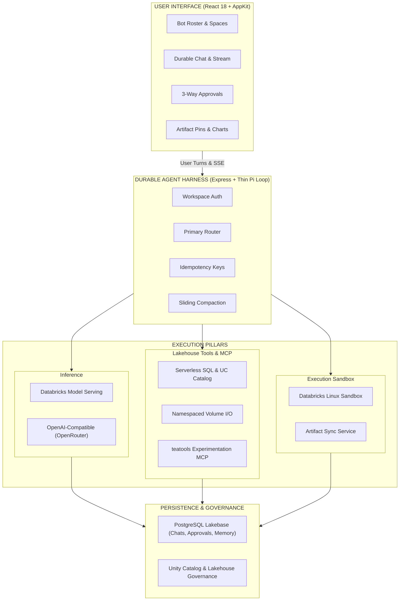

# 🧱 BricksBot

**Native Multi-Agent Lakehouse Assistant for Databricks Workspaces** — Spaces, bot roster, durable chat, lakehouse tools, 3-way approvals, and automated routines. Install directly as a Databricks App via Databricks Asset Bundles (DAB + source). Not a closed Marketplace container; not a Rakazo fork.

<p align="center">
  <a href="https://github.com/matheusbuniotto/bricksbot/actions/workflows/ci.yml"></a>
  <a href="LICENSE"></a>
  <a href="https://docs.databricks.com/dev-tools/bundles/index.html"></a>
  <a href="https://react.dev"></a>
  <a href="https://www.typescriptlang.org"></a>
</p>

<p align="center">
  
</p>

| | |
| --- | --- |
| **Is** | Workspace-installable AppKit app; OpenAI-compatible or Serving LLMs; SQL / UC catalog / Volume read & write / web fetch; Primary → teammate handoff; Ask-first approvals; scheduled routines via Job → webhook; optional sandbox exec |
| **Is not** | Desktop/browser “computer” UI; always-on Genie; PartnerOps listing required |

System architecture: [docs/architecture.md](docs/architecture.md) • Documentation index: [docs/README.md](docs/README.md) • Product locks: [docs/project-context.md](docs/project-context.md) • Community roadmap: [docs/roadmap-next.md](docs/roadmap-next.md)

---

## Why BricksBot? (Engineered for Databricks)

Most AI assistant projects on Databricks either wrap third-party SaaS chatbots (violating enterprise data boundaries) or run brittle Python LangChain scripts that lack durability, corrupt message order, and try to run unvalidated SQL.

BricksBot is built differently:

1. **Runs Natively Inside Databricks**: Deployed via Databricks Asset Bundles (DAB) directly into your workspace as an AppKit application. Durable chat state, approval events, and memories live in your own PostgreSQL Lakebase instance.
2. **Strict 3-Way Human Approvals**: Sensitive tools (`sql_query`, `volume_write`, sandbox operations) pause turn execution with an interactive card (`[Always allow] [Approve Once] [Deny]`). All decisions append to an immutable audit trail (`bricksbot.approval_events`).
3. **Grok-Style Multi-Agent Roster & Handoff**: A front-desk **Primary router** delegates specialized work to teammate bots (e.g., SQL Analyst, Experimentation Engine, Routine Runner) with bidirectional transcript links.
4. **Unity Catalog Native Tools**: Read-only Serverless SQL preflight with row limits and byte budgets. `volume_write` enforces user- and bot-namespaced folders (`/Volumes/.../users/{user}/bots/{bot}/`) with Lakebase quotas.
5. **Zero-Egress Serving Option**: Connect to external OpenAI-compatible models (OpenRouter) or keep all model traffic inside your VPC with Databricks Model Serving (DBRX, Llama 3 70B).
6. **Automated Lakeflow Routines**: Trigger recurring agent prompts on cron schedules via Databricks Jobs and authenticated webhooks.
7. **Thin Pi-Compatible Durable Harness**: Pure TypeScript agent loop without heavy framework dependencies. Sliding-window compaction caps prompt token budgets while raw transcript history is never deleted.

---

## Architecture at a Glance



*Deep dive: see [docs/architecture.md](docs/architecture.md) for layer-by-layer specifications and [docs/system-architecture.html](docs/system-architecture.html) for the interactive reference.*

---

## Example Walkthrough: Multi-Agent Lakehouse Analysis

1. **User asks**: *"Analyze our top 5 enterprise accounts by churn probability and graph revenue at risk."*
2. **Primary evaluates & delegates**: Primary plans the approach and executes `handoff_to_bot("SQL Analyst", ...)`. A clean handoff badge appears in both bot chats.
3. **Preflight human approval**: The SQL Analyst evaluates the generated SQL query against Serverless SQL warehouse boundaries and pauses the turn with a 3-way approval card.
4. **One-click signoff**: The operator reviews the SQL statement and approves (`Once` or shortcut `B`). The query executes in 28ms with Unity Catalog governance and row limits.
5. **Chart auto-pinning**: An interactive Vega-Lite chart pins directly to the transcript showing MRR exposure per account.
6. **Automated routine**: The analyst schedules a weekly Lakeflow Job webhook routine to track future churn alerts automatically.

---

## Quickstart

### Option A: Local Development (No Databricks Required)

You can clone and run BricksBot locally in 30 seconds. Without Databricks credentials, it boots with an in-memory store and a stub LLM client:

```bash
git clone https://github.com/matheusbuniotto/bricksbot.git
cd bricksbot
npm ci
npm test
npm run build
npm run dev
```

Open [http://localhost:8000](http://localhost:8000) to inspect the roster, transcript, and approval UI. Copy `.env.example` → `.env` only if you want to provide real LLM keys or local Lakebase credentials.

---

### Option B: Deploy to Databricks Workspace

You need: **App** + **Lakebase** (durable chat) + **secret for an LLM** (or Serving). A SQL warehouse is optional but required for interactive `sql_query` / `lakehouse_catalog`.

#### 1. Workspace Variables

Copy the example and fill your workspace parameters:

```bash
cp dev.local.yml.example dev.local.yml
# edit lakebase_branch, lakebase_database, sql_warehouse_id
```

`dev.local.yml` is gitignored and automatically loaded via `include: '*.local.yml'` in `databricks.yml`.

#### 2. Lakebase (BYO)

Create or reuse a Lakebase Autoscaling project/branch:

```bash
databricks postgres list-projects -p <profile>
```

Set in `dev.local.yml`:
- `lakebase_branch`: `projects/<project>/branches/<branch>`
- `lakebase_database`: `…/databases/databricks-postgres`

Schema `bricksbot` is owned by the App service principal after the first deploy.

#### 3. LLM Secrets and Egress

Default LLM secret scope/key: **`bricksbot` / `openrouter-api-key`**.

```bash
databricks secrets create-scope bricksbot -p <profile>   # if missing
databricks secrets put-secret bricksbot openrouter-api-key --string-value 'YOUR_KEY' -p <profile>
# optional web_fetch hosts (comma-separated); then uncomment the
# web-fetch-allowlist resource in databricks.yml and WEB_FETCH_ALLOWLIST in app.yaml
databricks secrets put-secret bricksbot web-fetch-allowlist --string-value 'docs.databricks.com' -p <profile>
```

| Capability | Notes |
| --- | --- |
| LLM Egress | OpenRouter (`openrouter.ai`) or your custom endpoint; or bind Serving (see `app.yaml`) |
| SQL Tools | Warehouse `CAN_USE` for the App SP; user needs UC grants (OBO via `sql:restricted-query`) |
| `volume_read` | User needs Volume read; App declares `files.files` |
| `volume_write` | Off by default. Create a Volume, then uncomment `BRICKSBOT_VOLUME_ROOT` in `app.yaml` with its `/Volumes/...` path. Signed-in user needs write permissions. Paths are isolated under `users/{user}/bots/{bot}/`. |
| Sandbox | `SANDBOX_BACKEND=databricks` in `app.yaml` (falls back to `python_exec` if Sandboxes preview is off). Set `off` to disable. |

To use **Databricks Model Serving** instead of OpenRouter: bind a `serving-endpoint` resource and set `LLM_PROVIDER=databricks` (see comments in `app.yaml`).

#### 4. Deploy

```bash
databricks bundle validate -p <profile>
databricks bundle deploy -p <profile>
databricks bundle run app -p <profile>
```

Check application status:

```bash
databricks apps get bricksbot -p <profile>
databricks apps logs bricksbot -p <profile>
```

Open the generated App URL → start chatting with **Primary**.

---

## Community FAQ (Databricks Admins & Engineers)

### Does my data leave Databricks?
**No, unless you choose external LLMs.** When configured with `LLM_PROVIDER=databricks`, all model inference runs through Databricks Model Serving within your cloud account. Serverless SQL queries run directly on your Databricks SQL Warehouse, and all state is stored in your PostgreSQL Lakebase.

### Can a bot execute destructive SQL or drop tables?
**No.** All SQL queries run with read-only statement preflight checks (`SELECT`, `WITH`, `SHOW`, `DESCRIBE`, `EXPLAIN`). Furthermore, sensitive tools require explicit **Human-in-the-Loop 3-Way Approval** before execution.

### Where is conversation history and memory stored?
All chat transcripts, bot profiles, memories, and approval audit logs are persisted in your workspace's **PostgreSQL Lakebase** database under the `bricksbot` schema.

### How are permissions and access governed?
BricksBot uses Databricks Workspace SSO headers (`x-forwarded-user`). Tool execution operates On-Behalf-Of (OBO) the active user, inheriting all Unity Catalog table grants, column masks, and row-level filters.

---

## Project Documentation

- [**System Architecture (`docs/architecture.md`)**](docs/architecture.md) — Comprehensive technical architecture reference.
- [**Documentation Index (`docs/README.md`)**](docs/README.md) — Complete catalog of all specs, ADRs, and plans.
- [**Durable Harness (`docs/durable-harness.md`)**](docs/durable-harness.md) — Deep dive into the Pi-compatible durable agent loop.
- [**OSS Release Map (`docs/oss-community-release.md`)**](docs/oss-community-release.md) — Checklist for open-source community distribution.
- [**Roadmap & Next Steps (`docs/roadmap-next.md`)**](docs/roadmap-next.md) — Post-release roadmap and feature backlog.

---

## License

BricksBot is open source software licensed under [Apache-2.0](LICENSE).
