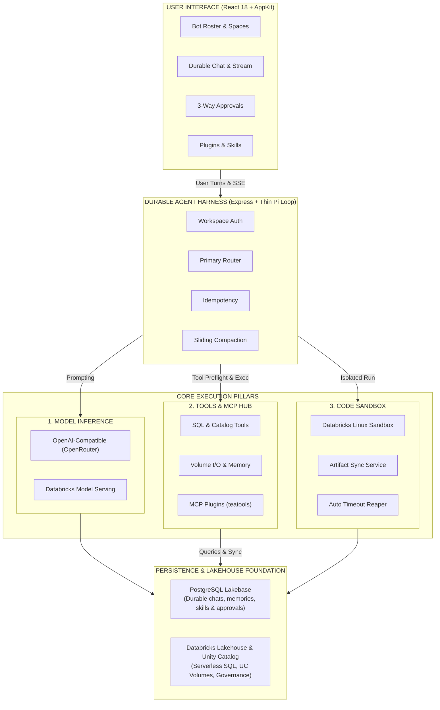

# BricksBot — System Architecture & Technical Interview Guide

This guide accompanies the interactive Excalidraw diagram [`docs/architecture-interview.excalidraw`](./architecture-interview.excalidraw).

---

## 1. Executive Summary & 30-Second Elevator Pitch

> **"BricksBot is an enterprise multi-agent lakehouse platform deployed natively inside Databricks as an AppKit application.** 
> Instead of using bloated, black-box agent frameworks like LangChain or CrewAI, we engineered a thin, **Pi-compatible durable harness** in pure TypeScript. It delivers crash-resilient multi-agent handoffs, strict 3-way human approvals (`always allow`, `once`, `deny`), sliding-window transcript compaction that preserves tool-call pairings, and direct lakehouse execution across Databricks Serverless SQL, Unity Catalog Volumes, and isolated Linux code sandboxes. Durable state lives in PostgreSQL Lakebase, ensuring zero data loss and complete auditability."

---

## 2. Interactive Excalidraw Architecture Diagram

The complete visual board is saved in two formats ready to open, edit, or present:
- [**`docs/architecture-interview.excalidraw`**](./architecture-interview.excalidraw) (Native Excalidraw format — drag and drop directly onto [excalidraw.com](https://excalidraw.com) or open with the VS Code/Cursor Excalidraw extension).
- [**`docs/architecture-interview.excalidraw.json`**](./architecture-interview.excalidraw.json) (Standard JSON export).

### High-Level Architecture Overview (Mermaid)

---

## 3. Layer-by-Layer Architectural Deep Dive

### Layer 1: Client & User Experience (React + AppKit)
- **Bot Roster & Spaces:** Supports multi-agent teams grouped into Personal and Shared Spaces. Presence state machine (`online`, `thinking`, `working`, `waiting`, `blocked`) gives visual feedback on whether a bot is reasoning, running a tool, or awaiting user approval.
- **Durable Transcript:** Renders real-time Server-Sent Events (SSE) streaming with rich UI components: tool execution chips, handoff peek views, artifact pins, and choice prompts.
- **Human-in-the-Loop Dialogs:** 3-way approval cards (`always allow`, `once`, `deny`) ensure users have granular control over mutating operations (such as SQL writes, Unity Catalog file modifications, and bot creations).
- **Connectors & Plugins Hub:** Dynamic discovery dialog managing native Lakehouse connectors, Databricks MCP servers (`system.ai.genie`, `system.ai.dbsql`), built-in TypeScript plugins (`plugin.teatools`), and per-bot skill packs.

### Layer 2: API Gateway & Durable Agent Harness (Express + Node/TS)
- **Thin Pi-Compatible Harness:** An agent harness inspired by Earendil's Pi architecture. Instead of pulling in massive third-party frameworks, we maintain an explicit loop with capability catalogs, skills index, and sliding-window compaction.
- **Idempotency & Crash Resilience:** Every user action passes a client-generated `requestId`. If a network connection drops or the server restarts mid-turn, the transaction reconverges idempotently without repeating side effects or duplicating tool calls.
- **Primary Router & Handoff:** A designated Primary bot acts as the front-desk router. Using `handoff_to_bot`, it delegates specialized tasks to teammate bots (e.g., SQL Data Analyst, Experimentation Bot) for one turn, summarizes the outcome, and links the conversations with bidirectional notification chips.
- **OpenAI-Compatible Tool Call Replay:** The harness guarantees that every LLM payload is strictly OpenAI-valid: assistant `tool_calls` always precede matching `tool` result messages, completely eliminating orphan tool errors.

### Layer 3: Model Clients & Inference
- **Dual Chat Client Architecture:**
  - **Primary:** High-reasoning OpenAI-compatible provider (OpenRouter delivering Claude 3.5 Sonnet, GPT-4o, or DeepSeek).
  - **Fallback:** Native Databricks Model Serving endpoints (DBRX, Llama 3 70B, or custom fine-tuned enterprise models) for zero-egress internal VPC security.
- **Strict Anti-Fast Model Policy:** Low-reasoning mini/flash models are banned from tool-calling roles to prevent hallucinated tool arguments and cascading multi-turn failures.

### Layer 4: Lakehouse Tools & MCP Extensibility
- **Lakehouse Native Tools:**
  - `sql_query`: Runs queries against Databricks Serverless SQL Warehouses with strict row limits, byte limits, and read-only preflight analysis.
  - `lakehouse_catalog`: Schema explorer navigating catalogs, schemas, tables, and column metadata.
  - `volume_read` / `volume_write`: Direct file operations on Databricks Unity Catalog Volumes.
- **Model Context Protocol (MCP) & Built-in Plugins:**
  - `system.ai.genie`: Opt-in conversational BI analytics through Databricks Genie.
  - `plugin.teatools`: Native zero-dependency TypeScript implementation of DataClaw's experimentation engine (A/B testing, Sample Ratio Mismatch checks, statistical power calculations, Cohen's kappa agreement).
- **Pi Meta-Tools & Memory:**
  - `activate_skill` / `read_skill_resource`: Loads skill definitions and reference templates progressively to guard prompt token budgets.
  - `remember` / `forget`: Stores durable facts in per-bot memory.
  - `save_skill`: Self-improving agent capability to codify successful workflows into reusable markdown skills.

### Layer 5: Phase 5 Isolated Code Sandbox
- **Container Execution:** Spins up dedicated, ephemeral Linux execution sandboxes per chat (using Databricks App Sandboxes preview, with fallbacks to `python_exec` or E2B).
- **Bi-Directional Artifact Sync:** Synchronizes files between the sandbox filesystem and Unity Catalog Volumes. Datasets are pulled into the sandbox, and generated plots, clean CSVs, or trained model artifacts are synced back to the lakehouse.
- **Security Guardrails:** Non-root execution, egress firewalls, automated idle timeout reapers, and mandatory Ask-first approvals for destructive sandbox operations.

### Layer 6: Persistence & Lakehouse Infrastructure
- **PostgreSQL Lakebase:**
  - Relational schema `bricksbot` storing spaces, bots, chats, messages, approvals, auto-approvals, audit trail events, compactions, routines, and sandbox sessions.
  - All multi-tenant operations are isolated by `(bot_id, user_id)`.
- **Unity Catalog & Databricks Platform:**
  - Enterprise governance, fine-grained ACLs, column-level masking, and lineage tracking.
  - Databricks Asset Bundles (`databricks.yml`) for automated, reproducible deployment across dev and prod workspaces.

---

## 4. Key Questions & Answers for Technical Interviews

### Q1: "Why build a custom agent harness instead of using LangChain, CrewAI, or AutoGen?"
> **Answer:** 
> "Most commercial agent frameworks suffer from three severe issues:
> 1. **Framework bloat & leaky abstractions:** They wrap standard HTTP JSON-RPC calls in complex class hierarchies that make debugging prompt formatting or tool pairing difficult.
> 2. **Fragile history handling:** When tool calls fail or require human approvals, off-the-shelf frameworks often corrupt message ordering or emit orphan tool outputs that fail strict LLM API contracts.
> 3. **Lack of enterprise durability:** LangChain and CrewAI assume in-memory state or ephemeral Python runtimes. BricksBot implements a thin **Pi-compatible durable harness** where every message, approval, compaction, and tool execution is persisted transactionally in PostgreSQL Lakebase. If the process is killed mid-turn, it resumes cleanly."

---

### Q2: "How do you handle Human-in-the-Loop approvals without blocking the web server?"
> **Answer:**
> "We separate turn execution from synchronous HTTP request cycles:
> 1. When a bot decides to invoke a sensitive tool (such as `sql_query` or `volume_write`), the preflight check determines if the action requires approval.
> 2. If approval is required, the tool call is persisted with state `pending` in the `approvals` table, the bot presence transitions to `waiting`, and the turn pauses cleanly.
> 3. The user sees an interactive approval card in the chat UI.
> 4. When the user selects `Once` or `Always allow`, the API records the decision, logs an immutable event to `approval_events` for auditing, and resumes `continueTurn` from the persisted message history."

---

### Q3: "How does the system prevent context window overflow over long conversations?"
> **Answer:**
> "We combine three complementary mechanisms:
> 1. **Sliding-window transcript compaction:** When accumulated messages approach the context budget, a background LLM summarizer rolls up older turns into a structured summary. Crucially, the raw messages are **never deleted** from Lakebase; they remain accessible to the user and for audit history.
> 2. **Pi-style on-demand skills indexing:** Instead of dumping full skill bodies into the system prompt, bots only receive an index (name + 1-sentence description). When a skill is needed, the bot calls `activate_skill` to load the full markdown body into the active turn.
> 3. **Hierarchical memory (OptMem exploration):** By organizing episodic facts into an append-only log with a binary summary tree, the bot's reading frontier scales logarithmically ($O(\log N)$) rather than linearly, capping memory prompt usage to a predictable budget."

---

### Q4: "How do you ensure multi-tenant security and data isolation inside Databricks?"
> **Answer:**
> "BricksBot operates under Databricks' enterprise security perimeter:
> 1. **Identity & RBAC:** Users authenticate via Databricks Workspace SSO. Spaces enforce role-based access (`viewer`, `member`, `admin`).
> 2. **Tenant Isolation:** All Lakebase queries strictly filter by `user_id` and `space_id`. Bots and memories owned by one user cannot be queried or updated by another.
> 3. **Lakehouse Governance:** Tool queries run against Databricks SQL Warehouses under Unity Catalog, inheriting all table-level ACLs, column masking, and row filters configured on the workspace."

---

## 5. How to Present This Diagram in an Interview

1. **Open the Diagram:**
   - Go to [excalidraw.com](https://excalidraw.com) and drag `docs/architecture-interview.excalidraw` onto the canvas.
   - Or open it directly inside VS Code / Cursor using the Excalidraw extension.
2. **Recommended Presentation Flow (5–7 minutes):**
   - **Minute 1: The Problem & Solution:** Introduce BricksBot as an enterprise AI platform bringing Grok Bot-like multi-agent collaboration directly onto the Databricks Lakehouse.
   - **Minute 2: The UI & Human-in-the-Loop (Layer 1):** Point to Zone 1, explaining 3-way approvals and presence states.
   - **Minute 3: The Durable Harness & Handoff (Layer 2):** Explain the Primary router pattern, idempotency keys, and why pure TypeScript beats framework bloat.
   - **Minute 4: Tools, MCP & Sandboxes (Zones 3, 4, 5):** Showcase Serverless SQL execution, Unity Catalog Volumes, the native `plugin.teatools` experimentation engine, and isolated Linux sandboxes.
   - **Minute 5: Lakebase & Enterprise Governance (Zone 6):** Conclude with PostgreSQL Lakebase persistence, Unity Catalog compliance, and automated deployment via Databricks Asset Bundles.
