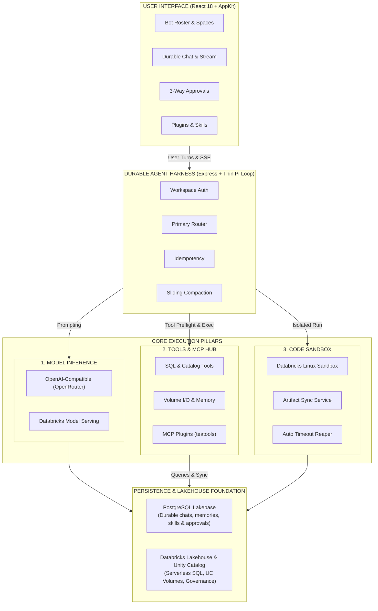

# BricksBot — System Architecture

**BricksBot is an enterprise multi-agent lakehouse platform deployed natively inside Databricks as an AppKit application.**

Instead of relying on heavy third-party agent frameworks, BricksBot implements a thin, **Pi-compatible durable harness** in pure TypeScript. It delivers crash-resilient multi-agent handoffs, strict 3-way human approvals (`all_the_time`, `once`, `not_approved`), sliding-window transcript compaction that preserves tool-call pairings, and direct lakehouse execution across Databricks Serverless SQL, Unity Catalog Volumes, and isolated code execution sandboxes. Durable state lives in PostgreSQL Lakebase, ensuring zero data loss and complete auditability.

---

## 1. High-Level Architecture

---

## 2. Layer-by-Layer Architecture

### Layer 1: Client & User Experience (React + AppKit)
- **Bot Roster & Spaces:** Multi-agent teams grouped into Personal and Shared Spaces. Presence state machine (`online`, `thinking`, `working`, `waiting`, `blocked`) gives visual feedback on whether a bot is reasoning, running a tool, or awaiting user approval.
- **Durable Transcript:** Renders real-time Server-Sent Events (SSE) streaming with tool execution chips, handoff peek views, artifact pins, and choice prompts.
- **Human-in-the-Loop Dialogs:** 3-way approval cards (`all_the_time`, `once`, `not_approved`) ensure users have granular control over mutating operations (such as SQL writes, Unity Catalog file modifications, and bot creations).
- **Connectors & Plugins Hub:** Dynamic discovery dialog managing native Lakehouse connectors, Databricks MCP servers (`system.ai.genie`, `system.ai.dbsql`), built-in TypeScript plugins (`plugin.teatools`), and per-bot skill packs.

### Layer 2: API Gateway & Durable Agent Harness (Express + Node/TS)
- **Thin Pi-Compatible Harness:** An explicit, crash-resilient agent loop with capability catalogs, skills index, and sliding-window compaction.
- **Idempotency & Crash Resilience:** Every user action passes a client-generated `requestId`. If a network connection drops or the server restarts mid-turn, the transaction reconverges idempotently without repeating side effects or duplicating tool calls.
- **Run model:** Every send, approval decision, and choice answer is a *run* (`chat_runs`): `running` until it answers, pauses (`waiting`), finishes, fails, or is stopped. A chat has at most one running run (partial unique index), so a second send gets `409 {activeRunId}`. A decision or choice after a pause starts a `resume` run that keeps the turn's `turn_id`. Runs append `run.started`, `tool.started|finished`, `approval.pending`, `assistant.committed`, `run.finished` to `run_events` (gap-free `seq` per chat, from `chats.event_seq`). A repeated `requestId` maps to the first run (unique `request_id`) instead of running twice.
- **Detached sends:** `POST /api/chats/:chatId/messages`, `/api/approvals/:id/decide` and `/api/chats/:chatId/choices/:id` accept `async: true` and answer `202 {runId}` once the message is saved; the sync path stays for the API and tests. The caller's access is re-checked before every model step, so unsharing a bot fails the run.
- **Stop:** `POST /api/chats/:chatId/runs/:runId/stop` aborts the model call and tool fetches (a tool that ignores the signal is abandoned). Streamed text is kept marked "(stopped)"; tool calls left unanswered get a synthetic tool row, so the next turn's history stays valid. Stop works across instances: the flag is in `chat_runs` and each running run checks it at its lease heartbeat.
- **Leases and the sweeper:** a running run renews `leases.run:<id>` every 10 s (TTL 30 s). Every 30 s each instance sweeps running runs whose lease lapsed (server died): it answers their dangling tool calls and marks them `failed`.
- **Primary Router & Handoff:** A designated Primary bot acts as the front-desk router. Using `handoff_to_bot`, it delegates specialized tasks to teammate bots for one turn, summarizes the outcome, and links conversations with bidirectional notification chips.
- **OpenAI-Compatible Tool Call Replay:** The harness guarantees that every LLM payload is strictly OpenAI-valid: assistant `tool_calls` always precede matching `tool` result messages, eliminating orphan tool errors.

### Layer 3: Model Clients & Inference
- **Dual Chat Client Architecture:**
  - **Primary:** High-reasoning OpenAI-compatible provider (OpenRouter delivering Claude 3.5 Sonnet, GPT-4o, or DeepSeek).
  - **Fallback:** Native Databricks Model Serving endpoints (DBRX, Llama 3 70B, or custom fine-tuned enterprise models) for zero-egress internal VPC security.
- **ChatClient contract:** `complete(request, { signal, onDelta })` returns content, tool calls, provider `usage` (tokens, cached, reasoning, provider `cost`), the answering `model` and `finishReason`. `request.model` overrides the default model (or Serving endpoint) per call. `signal` aborts the call; `onDelta` is reserved for token streaming.
- **Anti-Fast Model Policy:** Low-reasoning mini/flash models are avoided for tool-calling roles to prevent hallucinated tool arguments and cascading multi-turn failures.

### Layer 4: Lakehouse Tools & MCP Extensibility
- **Lakehouse Native Tools:**
  - `sql_query`: Runs queries against Databricks Serverless SQL Warehouses with strict row limits, byte limits, and read-only preflight analysis.
  - `lakehouse_catalog`: Schema explorer navigating catalogs, schemas, tables, and column metadata.
  - `volume_read` / `volume_write`: Direct file operations on Databricks Unity Catalog Volumes (namespaced per user and per bot with quotas).
- **Model Context Protocol (MCP) & Built-in Plugins:**
  - `system.ai.genie`: Opt-in conversational BI analytics through Databricks Genie.
  - `plugin.teatools`: Native zero-dependency TypeScript implementation of experimentation tools (A/B testing, Sample Ratio Mismatch checks, statistical power calculations, Cohen's kappa agreement).
  - Dynamic plugin loader: Loads extensible tools at runtime from Unity Catalog Volumes without monorepo rebuilds.
- **Pi Meta-Tools & Memory:**
  - `activate_skill` / `read_skill_resource`: Loads skill definitions and reference templates progressively to guard prompt token budgets.
  - `remember` / `forget`: Stores durable facts in per-bot memory.
  - `save_skill`: Self-improving agent capability to codify successful workflows into reusable markdown skills.

### Layer 5: Isolated Code Execution Sandbox
- **Container Execution:** Dedicated, ephemeral Linux execution sandboxes per chat (using Databricks App Sandboxes preview, with fallbacks to `python_exec` or E2B).
- **Bi-Directional Artifact Sync:** Synchronizes files between the sandbox filesystem and Unity Catalog Volumes. Datasets are pulled into the sandbox, and generated plots, clean CSVs, or trained model artifacts are synced back to the lakehouse.
- **Security Guardrails:** Non-root execution, egress firewalls, automated idle timeout reapers, and mandatory Ask-first approvals for destructive sandbox operations.

### Layer 6: Persistence & Lakehouse Infrastructure
- **PostgreSQL Lakebase:**
  - Relational schema `bricksbot` storing spaces, bots, chats, messages, approvals, auto-approvals, audit trail events, compactions, routines, and sandbox sessions.
  - All multi-tenant operations are isolated by `(bot_id, user_id)`.
- **Unity Catalog & Databricks Platform:**
  - Enterprise governance, fine-grained ACLs, column-level masking, and lineage tracking.
  - Databricks Asset Bundles (`databricks.yml`) for automated, reproducible deployment across dev and prod workspaces.

---

## 3. Core Architectural Principles

### Custom Harness vs Heavy Frameworks
Commercial frameworks (LangChain, CrewAI) wrap HTTP calls in deep class hierarchies that complicate prompt tuning, corrupt tool call pairing on errors, and default to in-memory state. BricksBot implements a thin, explicit loop where every turn, approval, and tool execution is persisted transactionally in PostgreSQL Lakebase.

### Asynchronous Human-in-the-Loop Approvals
Sensitive tools (`sql_query`, `volume_write`, sandbox operations) evaluate approval policies before execution. When human approval is required:
1. The tool call is persisted with state `pending`.
2. Bot presence transitions to `waiting`.
3. The turn pauses cleanly without consuming server resources.
4. When the user approves or denies, an immutable event is written to `approval_events` and the turn resumes cleanly.

### Context Window Management & Compaction
1. **Sliding-window compaction:** Older turns roll up into structured summaries when approaching token budgets, while raw messages remain persisted in Lakebase for auditability.
2. **On-demand skills indexing:** Bots only receive skill names and one-sentence summaries in the initial prompt, calling `activate_skill` to load full bodies on demand.
3. **Logarithmic memory hierarchy:** Memory frontier scales cleanly to keep memory prompt overhead bounded.

### Security Perimeter & Tenant Isolation
1. **Workspace SSO Identity:** Authenticates via Databricks Workspace headers (`x-forwarded-user`, `x-forwarded-access-token`).
2. **Tenant Boundaries:** All store operations enforce user and space scoping.
3. **Lakehouse Governance:** SQL and Volume operations inherit Databricks Unity Catalog permissions, row filters, and column masks.

---

## Gateway limits (X1)

The Databricks Apps gateway reportedly cuts requests at about 2 minutes (forum reports, not official docs), and nothing documents SSE or upload limits. PR 1.1 ships a harness to measure them on a deployed App. **Results: not run yet.**

1. Deploy this branch to the dev App with `BRICKSBOT_DIAG=1` set (the `/api/_diag/stream` and `/api/_diag/upload` probes do not exist otherwise).
2. Run `scripts/smoke-sse.sh https://<app-url> [profile]` (about 6 minutes). It checks:
   - (a) an SSE stream held 5 minutes with a server-side close every 90 s, `Last-Event-ID` resume, no buffering, no compression;
   - (b) whether the cut near 120 s is idle or absolute (a silent and a busy 150 s stream, side by side);
   - (c) a 25 MiB upload arrives intact;
   - (d) an upload whose sink takes 130 s.
3. Paste the output table here and unset `BRICKSBOT_DIAG`. If (a) fails, live runs fall back to polling; if (c) fails, the upload limit drops. Remove the probes (`server/diag/`) once recorded.
