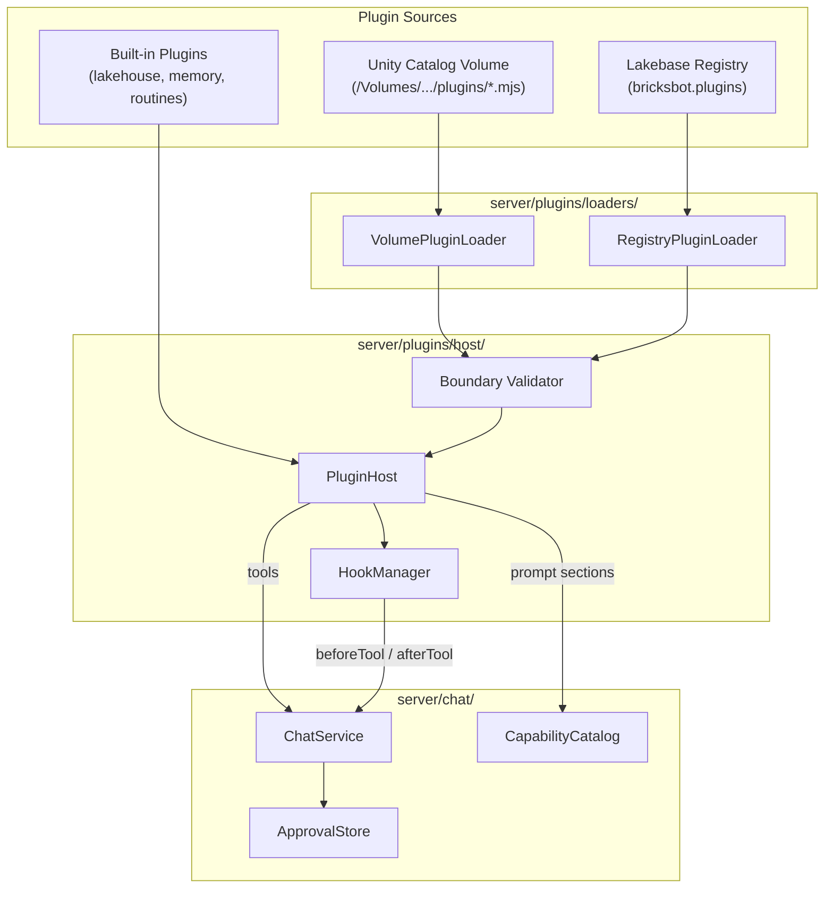
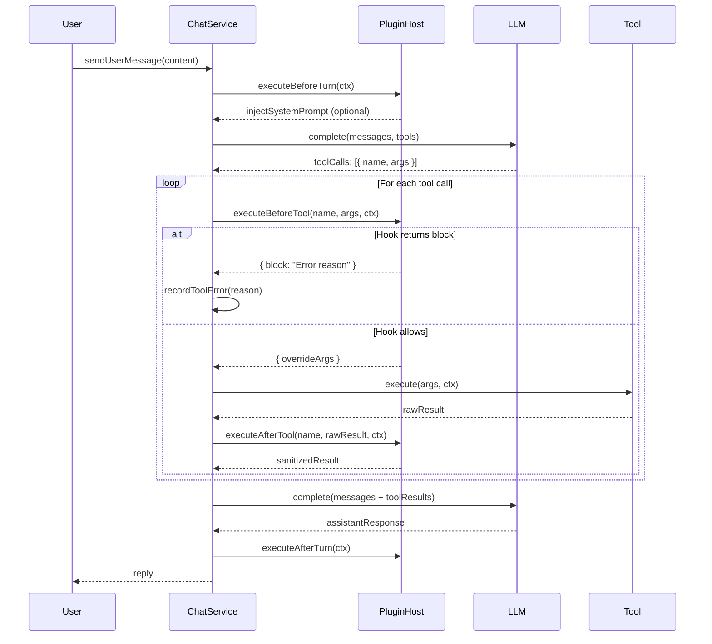

# Technical design: Plugin and extension system

- **Status:** Proposed
- **Date:** 2026-11-07
- **Author:** Engineering team
- **Related ADR:** [ADR 0001: Plugin and extension contract layer](../adr/0001-plugin-and-extension-contract.md)
- **Affects:** `shared/plugins/`, `server/plugins/`, `server/chat/`, `shared/agents/capability-catalog.ts`

## 1. Problem and goals

### 1.1 Context

BricksBot is a Databricks App. Users interact with bots that execute Lakehouse tools such as `sql_query`, `lakehouse_catalog`, `volume_read`, and `volume_write`.

Currently, `ChatService` in `server/chat/service.ts` registers all tools directly in its constructor. Adding an integration requires editing monorepo source files, building the TypeScript project, and deploying a new Databricks App bundle with `databricks bundle deploy`.

Enterprise workspaces require custom capabilities that should not live in the core BricksBot monorepo. Examples include internal ServiceNow clients, proprietary ERP connectors, compliance audit hooks, and custom data catalog queries. Maintaining a separate Git fork for each enterprise deployment is costly and blocks upstream updates.

### 1.2 Goals

- Provide a stable TypeScript contract in `shared/plugins/types.ts` for tools, prompt sections, and lifecycle hooks.
- Allow operators to install plugins dynamically from Unity Catalog Volumes without modifying or redeploying monorepo code.
- Provide a `PluginHost` that manages the plugin lifecycle and exposes loaded tools to `ChatService`.
- Integrate plugin tools into the existing three-way approval system (`all_the_time`, `once`, `not_approved`).
- Support prompt sections contributed by plugins so tools can inject instructions into the system prompt.
- Provide lifecycle hooks (`beforeTurn`, `afterTurn`, `beforeTool`, `afterTool`) to support audit logging and argument guardrails.

### 1.3 Non-goals

- Dynamic package installation via `npm install` inside running App containers. Databricks App containers run with read-only filesystems. External plugins must arrive pre-bundled as self-contained ECMAScript modules.
- Replacing Databricks Unity Catalog MCP connectors. MCP remains the primary standard for remote microservices. Plugins address in-process tools and prompt customizations.
- In-process execution of untrusted user scripts. User scripts must continue to execute in Phase 5 Linux sandboxes.

## 2. Architecture overview



The system contains four distinct layers:

1. **Contract layer (`shared/plugins/`)**: Pure type definitions. No external framework dependencies.
2. **Loaders (`server/plugins/loaders/`)**: Boundary adapters that discover and parse plugin bundles from Unity Catalog Volumes, Lakebase tables, or local directories.
3. **Host (`server/plugins/host/`)**: Validates loaded plugins, manages registration state, and dispatches lifecycle events.
4. **Agent runtime integration (`server/chat/`)**: `ChatService` queries `PluginHost` for tools and routes tool approvals and turn lifecycles through plugin hooks.

## 3. Data shapes and interfaces

### 3.1 Plugin definition

Plugins define their capabilities using `BricksbotPlugin` or export an initialization function that receives `BricksbotPluginAPI`.

```typescript
// shared/plugins/types.ts

export interface PluginMetadata {
  name: string;
  version: string;
  description: string;
  author?: string;
}

export interface PluginToolDefinition {
  name: string;
  description: string;
  parameters: Record<string, unknown>;
  askFirst?: boolean;
  neverAlwaysAllow?: boolean;
  annotations?: {
    readOnly?: boolean;
    destructive?: boolean;
  };
  execute(args: Record<string, unknown>, ctx: PluginExecutionContext): Promise<string>;
}

export interface PluginPromptSection {
  name: string;
  render(ctx: PluginPromptContext): Promise<string | undefined> | string | undefined;
}

export interface PluginHooks {
  beforeTurn?: (ctx: PluginTurnContext) => Promise<{ injectSystemPrompt?: string } | void>;
  afterTurn?: (ctx: PluginTurnContext) => Promise<void>;
  beforeTool?: (
    toolName: string,
    args: Record<string, unknown>,
    ctx: PluginExecutionContext
  ) => Promise<{ block?: string; overrideArgs?: Record<string, unknown> } | void>;
  afterTool?: (
    toolName: string,
    result: string,
    ctx: PluginExecutionContext
  ) => Promise<string | void>;
}

export interface BricksbotPlugin {
  metadata: PluginMetadata;
  tools?: PluginToolDefinition[];
  promptSections?: PluginPromptSection[];
  hooks?: PluginHooks;
}

export type PluginInitializer = (api: BricksbotPluginAPI) => void | Promise<void>;
```

### 3.2 Context shapes

Context objects pass necessary workspace and turn information to plugins without leaking Express request internals.

```typescript
export interface PluginExecutionContext {
  chatId: string;
  botId: string;
  userId?: string;
  userToken?: string;
  host: string;
  log: {
    info(message: string, data?: unknown): void;
    warn(message: string, data?: unknown): void;
    error(message: string, error?: unknown): void;
  };
}

export interface PluginPromptContext {
  chatId: string;
  botId: string;
  botName: string;
  isPrimary: boolean;
}

export interface PluginTurnContext extends PluginExecutionContext {
  messages: Array<{ role: string; content: string }>;
  model: string;
}
```

### 3.3 Plugin API

The `BricksbotPluginAPI` interface allows plugins to register tools, prompt sections, and hooks programmatically:

```typescript
export interface BricksbotPluginAPI {
  readonly metadata: PluginMetadata;
  registerTool(tool: PluginToolDefinition): void;
  registerPromptSection(section: PluginPromptSection): void;
  onBeforeTurn(handler: NonNullable<PluginHooks['beforeTurn']>): void;
  onAfterTurn(handler: NonNullable<PluginHooks['afterTurn']>): void;
  onBeforeTool(handler: NonNullable<PluginHooks['beforeTool']>): void;
  onAfterTool(handler: NonNullable<PluginHooks['afterTool']>): void;
}
```

## 4. Discovery and loading mechanisms

### 4.1 Unity Catalog Volume loader

The Unity Catalog Volume loader allows administrators to deploy new plugins without recompiling the application.

1. The operator uploads a bundled ECMAScript module (`plugin.mjs`) to a designated Volume path:
   ```text
   /Volumes/catalog/schema/bricksbot_plugins/{plugin-name}/index.mjs
   ```
2. The Databricks App reads the root directory path from the environment variable:
   ```text
   BRICKSBOT_PLUGIN_VOLUME=/Volumes/catalog/schema/bricksbot_plugins
   ```
3. At application startup, `VolumePluginLoader` scans subdirectories under this path.
4. For each directory containing an `index.mjs` file, the loader imports the module using dynamic `import()`.
5. The loader validates that the module exports either a default `BricksbotPlugin` object or a default `PluginInitializer` function.
6. The loader instantiates the plugin and registers it with `PluginHost`.

To prevent module caching issues during runtime reloads, the loader appends a version or timestamp query parameter when importing files:

```typescript
const moduleUrl = pathToFileURL(indexPath).href + `?t=${Date.now()}`;
const imported = await import(moduleUrl);
```

### 4.2 Lakebase configuration registry

A Lakebase table tracks installed plugins and their configuration parameters:

```sql
CREATE TABLE IF NOT EXISTS bricksbot.plugins (
  id UUID PRIMARY KEY,
  name TEXT NOT NULL UNIQUE,
  source TEXT NOT NULL CHECK (source IN ('volume', 'npm', 'builtin')),
  source_path TEXT NOT NULL,
  enabled BOOLEAN NOT NULL DEFAULT true,
  config JSONB NOT NULL DEFAULT '{}'::jsonb,
  created_at TIMESTAMPTZ NOT NULL DEFAULT NOW(),
  updated_at TIMESTAMPTZ NOT NULL DEFAULT NOW()
);

CREATE INDEX IF NOT EXISTS idx_bricksbot_plugins_enabled
  ON bricksbot.plugins(enabled);
```

The table enables administrators to:

- Enable or disable specific plugins per workspace without deleting files from Volumes.
- Supply sensitive plugin options via JSON without placing secrets in plain source code.

## 5. Agent loop and approval integration

### 5.1 Registration in `ChatService`

`ChatService` receives an instance of `PluginHost` in its constructor options. The service merges plugin tools with built-in tools:

```typescript
const pluginTools = this.pluginHost.getRegisteredTools();
this.baseTools = [...builtinTools, ...pluginTools];
```

### 5.2 Approval defaults

Security is a primary requirement for dynamic plugins. All plugin tools follow strict approval rules:

1. By default, every plugin tool requires Ask-first approval.
2. A plugin tool may bypass Ask-first approval only if it explicitly declares `annotations.readOnly: true`.
3. If a tool sets `neverAlwaysAllow: true`, the approval dialog will not offer the "Always allow" option to the user.
4. Handoff turns do not automatically approve plugin tools unless those tools are marked read-only.

### 5.3 Lifecycle hook execution



- **`beforeTurn`**: Evaluated before the first LLM call in a turn. A plugin can inject prompt context or validate turn preconditions.
- **`beforeTool`**: Evaluated before argument preflight and approval checks. A security hook can inspect arguments and block execution. If blocked, the tool execution halts immediately and returns the error message to the LLM.
- **`afterTool`**: Evaluated after tool execution finishes. A redaction hook can filter sensitive credentials, tokens, or PII before results enter the LLM transcript.
- **`afterTurn`**: Evaluated when the assistant finishes its reply. Used for audit logging or metrics dispatch.

## 6. Prompt integration

Plugins can contribute dynamic prompt sections via `PluginPromptSection`.

In `shared/agents/capability-catalog.ts`, `formatCapabilityPrompt()` calls `PluginHost.getPromptSections()` and appends rendered sections to the system prompt.

Rules for prompt sections:

1. A prompt section must return `undefined` if it has no data to contribute for the active bot.
2. Each section must not exceed 500 characters to prevent context window bloat.
3. Content returned by prompt sections must contain factual constraints or instructions, not greeting text or redundant descriptions.

## 7. Security considerations

1. **Execution isolation:** Plugins loaded via the Volume loader run in the same Node.js process as the BricksBot application. Databricks Unity Catalog permissions protect the plugin Volume. Only workspace administrators should have `WRITE_VOLUME` privileges on the plugin root path.
2. **Untrusted code:** Code from untrusted external sources must never be dropped into the plugin Volume. When users require arbitrary script execution, they must use the Phase 5 Linux sandbox tools (`python_exec` or `sandbox_exec`).
3. **Secret access:** Plugins must not read environment variables directly. They must access credentials via `ctx.userToken` or via explicit configuration passed from Lakebase.

## 8. Implementation sequence

### Phase 1: Pure types and host

- Create `shared/plugins/types.ts` defining all plugin and context interfaces.
- Create `server/plugins/host/plugin-host.ts` with registration, validation, and hook execution logic.
- Add unit tests for `PluginHost` covering tool registration and hook ordering.

### Phase 2: ChatService integration

- Add `pluginHost` to `ChatServiceOptions` in `server/chat/service.ts`.
- Wire `PluginHost.getRegisteredTools()` into tool resolution.
- Wrap tool execution with `beforeTool` and `afterTool` hooks.
- Add unit tests verifying that hooks can block or sanitize tool outputs.

### Phase 3: Volume and registry loaders

- Implement `server/plugins/loaders/volume-loader.ts` to scan UC Volumes and dynamically import modules.
- Create Lakebase migration script for the `bricksbot.plugins` table.
- Implement `RegistryPluginLoader` to query Lakebase and activate configured plugins.
- Provide a refresh endpoint (`POST /api/admin/plugins/reload`) to reload plugins without restarting the App.

### Phase 4: Migration of built-in tools

- Refactor existing Lakehouse tools into internal plugins under `server/plugins/builtin/`.
- Verify that standard test suites pass without regressions.
